<picture>
  <source media="(prefers-color-scheme: dark)" srcset="./assets/hero-dark.svg">
  <source media="(prefers-color-scheme: light)" srcset="./assets/hero-light.svg">
  
</picture>

I take products from 0→1 and then from 1→100. I own the stack end to end, from the schema to the last pixel of the UI, and I care about what happens after launch as much as the launch.

### `$ ls ~/shipped`

<table>
  <tr>
    <td width="50%" valign="top">
      <h4><a href="https://github.com/Ishaan2053/war-room">war-room</a> · <a href="https://war-room-web.vercel.app">live</a></h4>
      <p>Incident operations copilot that turns scattered signals into one auditable workflow: intake, timeline, Slack coordination, tickets and postmortems.</p>
      <p>Joins 10 sources (GitHub, Sentry, Datadog, PagerDuty, Grafana and more) and shows the SQL, rows and confidence behind every conclusion. Remediation always waits for approval.</p>
      <code>Next.js</code> <code>Supabase</code> <code>FastAPI</code> <code>LangGraph</code>
    </td>
    <td width="50%" valign="top">
      <h4><a href="https://github.com/Ishaan2053/openmetadata-data-impact-action">openmetadata-data-impact-action</a></h4>
      <p>GitHub Action that reads the SQL and dbt changes in a pull request, walks downstream lineage in OpenMetadata, and comments with the risk before anything merges.</p>
      <p>Scores risk from blast radius, critical tags and ownership. Contract-tested against three OpenMetadata lineage formats, and fails closed: if analysis breaks, the PR is marked high risk.</p>
      <code>TypeScript</code> <code>GitHub Actions</code> <code>MCP</code>
    </td>
  </tr>
  <tr>
    <td width="50%" valign="top">
      <h4><a href="https://github.com/Ishaan2053/keystone">keystone</a> · <a href="https://keystone-one-ebon.vercel.app">live</a></h4>
      <p>Issue triage that shows its work. An agent over a graph of an org's GitHub history finds the affected code, ranks reviewers and surfaces past decisions, each with the graph path that supports it.</p>
      <p>On 50 held-out issues it picked the right module first 54% of the time, against 10% for CODEOWNERS. Claims without evidence are dropped before display.</p>
      <code>FalkorDB</code> <code>Python</code> <code>FastAPI</code> <code>Next.js</code>
    </td>
    <td width="50%" valign="top">
      <h4><a href="https://github.com/Ishaan2053/bugline">bugline</a></h4>
      <p>Support-to-engineering loop. A front-desk agent takes bug reports from users on Telegram and hands them to reproducer and fixer agents in an engineering room on Slack.</p>
      <p>The full loop runs end to end, with a refusal gate at the front desk and a cap of five open tickets per reporter.</p>
      <code>Python</code> <code>AI agents</code> <code>Telegram</code> <code>Slack</code>
    </td>
  </tr>
</table>

Also: [obligence](https://github.com/kyrexi/obligence), an AI agent that parses contracts and surfaces insights, and [trafyx](https://github.com/kyrexi/trafyx), automated API testing with Go and GenAI.

### `$ cat stack.txt`

```text
build   TypeScript · Python · Go · Next.js · React · FastAPI · Node.js
data    PostgreSQL · MongoDB · Firebase
ship    GCP · Vercel · GitHub Actions
```

### `$ git log --stat`

<picture>
  <source media="(prefers-color-scheme: dark)" srcset="./profile/stats-dark.svg">
  <source media="(prefers-color-scheme: light)" srcset="./profile/stats-light.svg">
  
</picture>

### `$ git log --oneline -5`

<!-- SHIPPED:START -->
- Latest merged pull requests appear here after the first workflow run.
<!-- SHIPPED:END -->

### `$ ls ~/writing`

<!-- HASHNODE:START -->
- `2026-11-07` [From a group message to a pull request and back: building Bugline on Switch](https://ishaan2053.hashnode.dev/from-a-group-message-to-a-pull-request-and-back-building-bugline-on-switch)
- `2026-10-18` [Keystone: an issue-triage agent that shows its work, built on a FalkorDB graph](https://ishaan2053.hashnode.dev/keystone-an-issue-triage-agent-that-shows-its-work-built-on-a-falkordb-graph)
<!-- HASHNODE:END -->

### `$ ./contact.sh`

[LinkedIn](https://www.linkedin.com/in/ishaan2053) · [X](https://x.com/Ishaan2053) · [Upwork](https://www.upwork.com/freelancers/~0180fcbb95041d5cb9) · [Hashnode](https://ishaan2053.hashnode.dev) · [Email](mailto:ishaan2053@gmail.com)

<details>
<summary><code>$ sudo hire Ishaan2053</code></summary>

```text
[sudo] password for you: ********
checking uptime ........ shipping since day one
checking scope ......... schema to pixel
checking availability .. always up for a good problem

permission granted. run ./contact.sh
```

</details>
